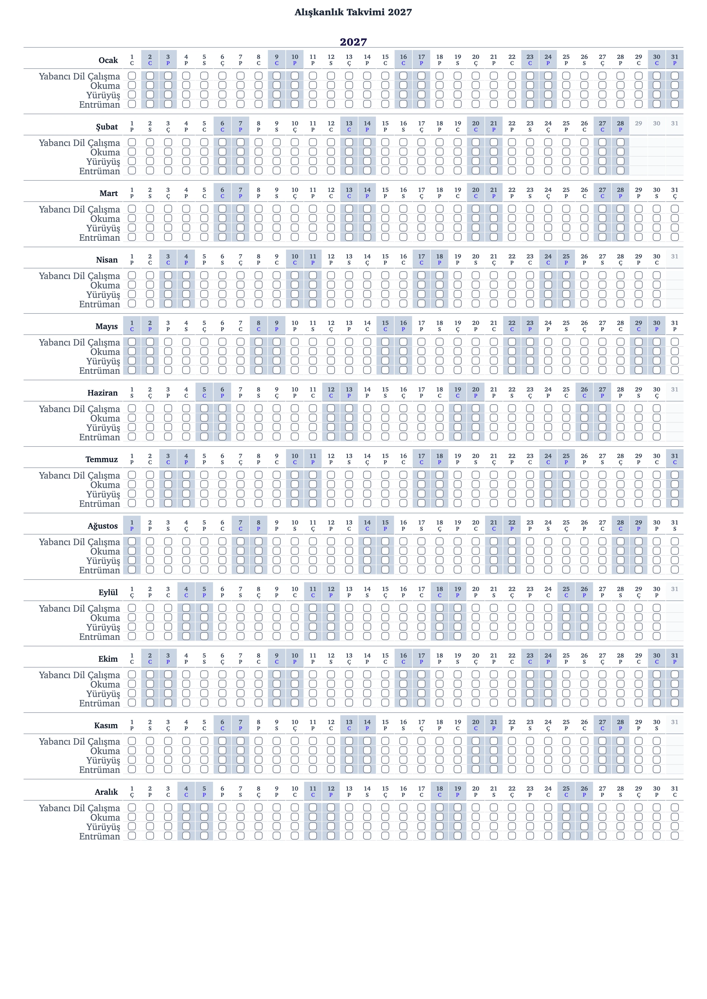

---

title: "habits2027 Kullanım Kılavuzu"
slug: "habits2027-kullanim-kilavuzu"
date: 2026-11-08 00:00:00
description: "habits2027 ile 2027-2028 alışkanlık takvimi nasıl kullanılır? Alışkanlık ekleme, haftalık ve periyodik takip, ay ve yıl seçimi, dil, yazdırma, PNG indirme, JSON yedekleme ve veri taşıma rehberi."
tags: ["alışkanlık", "habit", "üretkenlik", "uygulama"]
author: "Alper Söylemez"
is_published: true
image: "/assets/images/blog/habits2027_2027_aliskanlik_takvimi_örnek.webp"
---

**[habits2027](https://alpersoylemez.com/habits2027/)**, 2027 ve 2028 yılları için tasarlanmış, yazdırılabilir ve dijital olarak doldurulabilen alışkanlık takip takvimidir. Her ay için ayrı bir satır topluluğu görür, alışkanlıklarınızı eklersiniz, işaretlemeleri yaparsınız ve dilerseniz takvimi A4 olarak yazdırırsınız.

> **Takvime ulaşmak için [habits2027](https://alpersoylemez.com/habits2027/) sayfasını açın.** Yatay görünüm için [habits2027/landscape](https://alpersoylemez.com/habits2027/landscape/) adresini kullanın. Kayıt gerekmez; veriler tarayıcınızda saklanır.

Bu kılavuz, sayfayı ilk kez açtığınızda neyin nerede olduğunu adım adım anlatır. Okuma süresi sadece birkaç dakika; takvim hayatınız boyunca tek bir dosyada gezinmekten daha kolay olacak.

## 1. Ekranın iki yarısı: Takvim Düzenleyici ve Takvim

Sayfa açıldığında sol tarafta **Takvim Düzenleyici** paneli, sağ tarafta ise takvim alanı yer alır. Düzenleyici paneli, takvimde ne göreceğinizi belirlediğiniz yerdir:

- Başlık metni ve sayfa yönü (Dikey / Yatay)
- Görünüm ayarları (yıl, aylar, gün harfleri, dil)
- Alışkanlık listesi ve yeni alışkanlık ekleme formu
- İndirme, yazdırma, yedekleme ve temizleme düğmeleri

Sağ taraftaki takvim alanında her bir alışkanlık için ayrı bir satır görmek için önce alışkanlık eklemeniz gerekir. Alışkanlık yoksa takvim iskeleti (ay adları, gün numaraları ve gün harfleri) görünür; işaretlenecek kutu yoktur.

Takvimde her gün hücresi için aynı yapıyı görürsünüz: Günün numarası, altında gün harfi ve satır kesişiminde işaretleme kutusu. Hafta sonları (Cumartesi ve Pazar) gri tonlamayla ayrılır. Ayın gün sayısından fazla olan numaralar pasif göründüğü için hangi günlerin gerçek olduğunu tek bakışta anlarsınız.

## 2. Alışkanlık ekleme: Ad, başlangıç tarihi ve takip modu

Yeni alışkanlığı eklemek için soldaki **"Yeni Alışkanlık Ekle"** alanını kullanın:

1. **Ad.** Kısa ve net bir başlık yazın. Örnek: *Yabancı dil çalışmak*, *Kitap okumak*, *Yürüyüş*.
2. **Başlangıç Tarihi.** Alışkanlığı ne zaman başlatmak istediğinizi seçin. Tarih, 2027-01-01 ile 2028-12-31 aralığında olmalıdır.
3. **Takip Modu.** İki seçenek vardır: *Haftalık Günler* veya *N Günde Bir*.

Takip modu seçimi, kutuların hangi günlerde görüneceğini belirler. Başlangıç tarihinden önceki günlerde kutu gösterilmez; sonraki günlerde modunuza uygun olanlar görünür.

**En fazla 5 alışkanlık** ekleyebilirsiniz. Adı zaten listede olan bir alışkanlığı tekrar ekleyemezsiniz. Alışkanlığı ekledikten sonra panelde listede görürsünüz; buradan arriba ve aşağı taşımanız, başlangıç tarihini görmeniz ve alışkanlığı silmeniz mümkündür.

### Haftalık mod

Haftanın belirli günleri için alışkanlık tanımlamak istiyorsanız *Haftalık Günler* seçeneğini kullanın. Örneğin, her Pazartesi, Çarşamba ve Cuma okumak istediğiniz alışkanlığı seçtiğiniz günlerde işaretlersiniz.

Haftalık modda en az bir gün seçmek zorunludur. Pzt, Sal, Çar, Per, Cum, Cmt, Paz kısaltmaları panelde görünür.

### Periyodik mod

*Her gün* yapmak zorunda olmadığınız, *N günde bir* yapılacak alışkanlıklar için *N Günde Bir* seçeneğini kullanın. Başlangıç tarihinden itibaren her N günde bir kutu görünür.

> **Örnek:** 2027-01-01 tarihinde başlatılan ve *2 Günde Bir* olarak ayarlanan bir alışkanlık 1, 3, 5, 7 Ocak günlerinde görünür; 2, 4, 6 Ocak günlerinde görünmez.

Tekrar sayısını 1 olarak ayarlarsanız alışkanlık her gün görünür. Tekrar sayısı en az 1 olmalıdır.

## 3. Gün işaretleme

Takvimi kullanmaya başladığınızda her gün alışkanlığınızı işaretlemek için kutuya tıklayın. İşaretlenen kutuda tik imgesi belirir; tekrar tıkladığınızda tik kalkar.

İşaretlemelerinizi yapmak için alışkanlığın gün kutusuna tıklamanız yeterlidir; ayrı bir kayıt adımı yoktur. Her tıklama tarayıcıda anında saklanır.

## 4. Takvimi özelleştirme

### Başlık

Paneldeki **Başlık** alanından takvim başlığını değiştirebilirsiniz. Başlık, takvim alanının üstünde büyük harflerle görünür. Başlık metnini yazdığınızda anında kaydedilir.

Örneğin, *Alışkanlık Takvimi 2027* yerine *2027 Hedef Takvimim* veya *2027 Kişisel Takip Takvimim* yazabilirsiniz.

### Yıl seçimi: 2027 veya 2028

**Yıl** bölümünden 2027 veya 2028 arasında geçiş yapabilirsiniz. Yılı değiştirdiğinizde:

- Aynı alışkanlık listesi her iki yıl için de geçerlidir.
- Takvimin görünümü seçili yılın takvimine göre güncellenir.
- Başlık hâlâ otomatik yıl biçimindeyse (*Alışkanlık Takvimi 2026* gibi), başlık yeni yıla göre güncellenir.

Manuel başlık yazdıysanız, yıl değişikliği başlığı değiştirmez.

### Gösterilecek ayları seçme

**Gösterilecek Ayları Seçin** bölümünden görmek istediğiniz ayları seçebilirsiniz. Varsayılan olarak 12 ayın tamamı görünür.

En az bir ay seçili olmalıdır. Bir ay seçiliyken kapatmaya çalıştığınızda uyarı görürsünüz.

Bu özellik, örneğin sadece ilk çeyreği yazdırmak veya yılın ikinci yarısını görmek istediğinizde kullanışlıdır.

### Gün harflerini gösterme

**Gün Harflerini Göster** düğmesi, gün numaralarının altında görünen gün harflerini açar veya kapatır. Örneğin, Türkçe'de P, S, Ç, P, C, C, P harfleri ve İngilizce'de M, T, W, T, F, S, S harfleri görünür.

Harfleri gizlediğinizde takvim sadeleşir; yazdırma öncesinde bu tercihi düzenleyebilirsiniz.

### Dil değiştirme: TR / EN

Panelin üstündeki **TR** ve **EN** düğmeleri panel ve takvim yazılarını değiştirir:

- Türkçe: Ocak, Şubat, Mart...
- İngilizce: January, February, March...

Dil seçimi, alışkanlık adlarınızı ve işaretlemelerinizi etkilemez; yalnızca arayüz metinlerini ve ay adlarını değiştirir.

### Dikey ve Yatay görünüm

**Sayfa Yönü** bölümünden *Dikey* ve *Yatay* arasında geçiş yapabilirsiniz:

- **Dikey:** A4 dikey sayfaya uygun uzun takvim. Sayfada aylar alt alta listelenir.
- **Yatay:** A4 yatay sayfaya uygun düzen. Ocak-Haziran sol tarafta, Temmuz-Aralık sağ tarafta görünür.

Yatay seçtiğinizde sayfa `/habits2027/landscape` adresine yönlenir ve tercih tarayıcıda kaydedilir. Böylece sonraki açılışta aynı yönde açılır.

## 5. Yazdırma ve görsel indirme

### Yazdır (A4 Dikey veya A4 Yatay)

- **Yazdır** düğmesi, takvim alanı ve kontrol paneli gizli olarak yazdırma görünümü oluşturur.
- Dikey görünümde A4 dikey sayfa boyutunda yazdırır; yatay görünümde A4 yatay (landscape) sayfada yazdırır.
- Yazdırma sırasında panel, düğmeler ve tarayıcı araçları görünmez; yalnızca takvim alanı sayfaya basılır.
- Yazdırma öncesi görmek istediğiniz ayları, gün harfleri tercihini ve başlığı düzenlemeniz yeterlidir.

### Görsel İndir (PNG)

**Görsel İndir** düğmesi takvim alanını PNG görseli olarak indirir. İnşa edilen görsel yüksek çözünürlüktedir ve dosya adı, seçili yıl, başlık ve tarih bilgisi içerir.

> İpucu: PNG dosyasını telefona kaydedip arşivleyebilir, paylaşabilir veya yazıcıya göndererek duvar takvimi gibi kullanabilirsiniz.

## 6. Yedekleme: Dışa aktar ve içe aktar

Veriler tarayıcınızda saklandığı için önemli verilerinizin bir yedeğini almak için JSON dışa aktarımını kullanın.

### Dışa Aktar - JSON

1. **Dışa Aktar - JSON** düğmesine basın.
2. Dosya adı `habit2027_backup_[yıl]_...` biçiminde JSON olarak bilgisayarınıza indirilir.
3. Bu dosyada başlık, alışkanlık listesi, işaretlemeler, görünüm ayarları ve dil seçimi saklanır.

### İçe Aktar - JSON

1. **İçe Aktar - JSON** düğmesine basın.
2. Daha önce dışa aktardığınız JSON dosyasını seçin.
3. Onay sorusunda mevcut alışkanlıkların ve işaretlemelerin silinip dosya içeriğiyle değiştirileceğini onaylayın.

İçe aktarma, verileri tarayıcıya geri yükler ve takvim güncellenir.

> **Uyarı:** İçe aktarma mevcut verileri değiştirir. Yedek bir JSON dosyanızı saklamak için önce dışa aktarma yapmanızı öneririz.

## 7. Veri ve saklama

### Veriler nerede saklanır?

Eklediğiniz alışkanlıklar, işaretlemeler, başlık ve görünüm ayarları tarayıcınızın **localStorage** alanı içinde saklanır. Aynı tarayıcıda sayfayı kapatıp açsanız bile verileriniz korunur.

Veriler sunucuya gönderilmez ve uzak bir veritabanında tutulmadan çalışır.

### Veriler hangi durumlarda kaybolur?

- Tarayıcı geçmişini, çerezleri veya site verilerini temizlerseniz
- Farklı bir tarayıcı veya farklı bir cihaz kullanırsanız
- Gizli / özel gezinme penceresinde çalışıyorsanız
- Tarayıcı verilerini elle silerseniz

Bu nedenle önemli veriler için düzenli olarak **Dışa Aktar** ile yedek alınız ve yedek dosyası saklayınız.

### Tüm Verileri Temizle

**Tüm Verileri Temizle** düğmesi listenizdeki alışkanlıkları ve işaretlemelerinizi siler. Onay sorusunda verilerin kalıcı olarak silinmesi istendiğini unutmayın. Bu işlem geri alınamaz.

## 8. Mobil görünüm

Mobil telefondan bakıyorsanız takvim yatay olarak kaydırılabilir veya ekranınıza sığdırılabilir modda görünebilir.

Panelin üstündeki mobil görünüm seçeneği ile *Kaydır* veya *Sığdır* arasında geçiş yapabilirsiniz. *Kaydır* modunda takvim kaydırılarak incelenir; *Sığdır* modunda takvim ekranınıza küçültülerek gösterilir.

## 9. Sık sorulan sorular

### Kaç alışkanlık ekleyebilirim?

En fazla **5** alışkanlık ekleyebilirsiniz. Listenin dolu olduğu durumda uyarı görürsünüz.

### Alışkanlığı neden göremiyorum?

- Başlangıç tarihinden önceki günlerde kutu görünmez.
- Haftalık modda seçtiğiniz günler dışında kutu görünmez.
- Periyodik modda tekrar aralığına uymayan günlerde kutu görünmez.

Örnek: 2027-03-01 başlangıç tarihi ile eklediğiniz alışkanlık Ocak ve Şubat aylarında takvimde yer almaz.

### Bir alışkanlığı düzenleyebilir miyim?

Alışkanlık adı ve takip modu doğrudan düzenlenemez. Alışkanlığı silip yeniden ekleyebilirsiniz; ancak silinen alışkanlığın kayıtları da silineceğinden önce *Dışa Aktar* ile yedek alınız.

### Sıralamayı nasıl değiştiririm?

Listede alışkanlığın yanında bulunan yukarı ve aşağı ok düğmeleriyle alışkanlık sıralamasını değiştirebilirsiniz. Sıralama takvimde görünen satır düzenini etkiler.

### Takvimi telefondan kullanabilir miyim?

Evet. Takvim mobil uyumludur. Görünüm modunu seçerek takvim alanını kaydırarak veya sığdırarak kullanabilirsiniz. Veriler telefonun tarayıcısında saklanır.

### habits2026 ile farkı ne?

- **habits2026** sayfası 2026 yılına özeldir.
- **habits2027** sayfası 2027 ve 2028 yıllarını içerir.
- Her yıl için ayrı sayfa ve başlık kullandığından karışıklık olmaksızın yılı ayırmak mümkündür.

### Başkalarıyla takvimi paylaşabilir miyim?

Takvimi PNG olarak indirip paylaşabilirsiniz. JSON dosyası yalnızca sizin tarayıcınıza geri yüklemek için kullanılabilir; paylaşım için PNG kullanmanız daha uygun olur.

## 10. Örnek başlangıç planı

Teknik bilgilere gerek kalmadan kullanmaya başlamak için şu adımları izleyin:

1. Başlığı *2027 Alışkanlık Takvimim* olarak düzenleyin.
2. Alışkanlık ekleyin: *Erken kalkmak*, başlangıç tarihi 2027-01-01, haftalık modda Pzt-Sal-Çar-Per-Cum günleri.
3. Alışkanlık ekleyin: *Kitap okumak*, başlangıç tarihi 2027-01-01, haftalık modda tüm günler.
4. Alışkanlık ekleyin: *Yabancı dil tekrarı*, başlangıç tarihi 2027-01-01, *2 Günde Bir* periyodik mod.
5. Yılı seçin: 2027. İstenmeyen ayları kapatabilirsiniz.
6. Her gün kutulara tıklayarak işaretleyin.
7. Ay sonunda *Görsel İndir* ile arşivleyin, *Dışa Aktar* ile JSON yedeği alın.
8. Dilediğinizde *Yazdır* düğmesiyle A4 çıktısı alın.

Sayfa: [habits2027 - Alışkanlık Takvimi](https://alpersoylemez.com/habits2027/)
