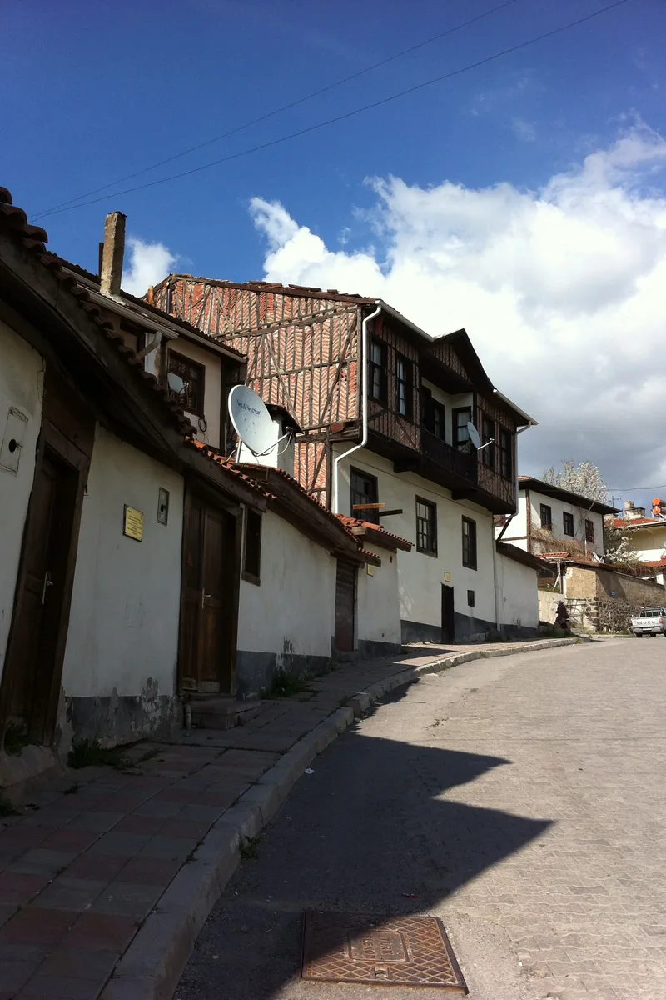
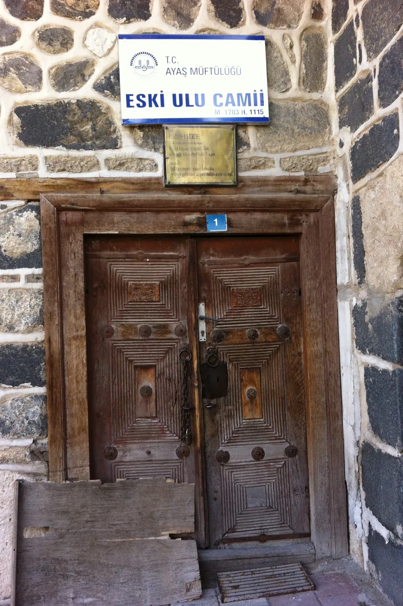
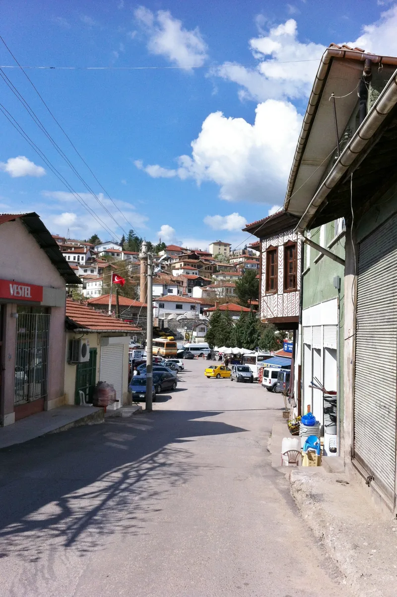

Ankara’nın batısında, şehir merkezine yaklaşık 55 km uzaklıkta ve 954 metre rakımda kurulan Ayaş; verimli toprakları, kaplıca ve içmeceleriyle uzun süredir bilinen bir ilçedir. 1.041 km²’lik yüzölçümüne yayılan köyleri Oğuz boylarının izlerini taşır; Bayat, Afşar, Peçenek, Kıpçak ve Kargın adlı yerleşimler bunun en somut örneğidir. Ayaş’ın adı Evliya Çelebi’nin eserlerinde ve yöre türkülerinde de geçer.

1554’te sancak merkezi olan, 1864’te ise Ankara’ya bağlı bir nahiye hâline gelen Ayaş, eğitim bakımından da öne çıkmıştır: 1900’lü yılların başında ilçede 8 medrese, 2 iptidai mektep ve 1 rüştiye bulunuyordu. Bugün merkezdeki dar sokaklarda sıralanan ahşap konaklar, Ulu Camii ve tarihi Paşa Hamamı geçmişin izlerini korumaya devam ediyor.

  
  
  

Kaplıcaları ve içmeceleriyle ünlü ilçede Asartepe Kanyonu, Yağmur Dede Türbesi ve çevresindeki geniş yeşillik alanlar doğaseverlerin uğrak noktalarındandır. Her yıl haziranın son haftası düzenlenen Dut Festivali, yörenin dut ağaçlarıyla kurduğu bağı kutlar; Ayaş domatesi de bölgenin bilinen lezzetlerinden biridir.

<small>Görseller: <a href="https://commons.wikimedia.org/wiki/File:Aya%C5%9F,_06710_Bayram-Aya%C5%9F-Ankara,_Turkey_-_panoramio.jpg" target="_blank" rel="noopener noreferrer">1</a>, <a href="https://commons.wikimedia.org/wiki/File:Aya%C5%9F,_06710_Bayram-Aya%C5%9F-Ankara,_Turkey_-_panoramio_(3).jpg" target="_blank" rel="noopener noreferrer">2</a>, <a href="https://commons.wikimedia.org/wiki/File:Aya%C5%9F_ankara_t%C3%BCrkiye_-_panoramio.jpg" target="_blank" rel="noopener noreferrer">3</a> — bynyalcin / Wikimedia Commons, <a href="https://creativecommons.org/licenses/by/3.0/" target="_blank" rel="noopener noreferrer">CC BY 3.0</a>. Kırpılıp WebP biçimine dönüştürülmüştür. Metin kaynağı: <a href="https://tr.wikipedia.org/wiki/Aya%C5%9F" target="_blank" rel="noopener noreferrer">Türkçe Vikipedi</a>.</small>

