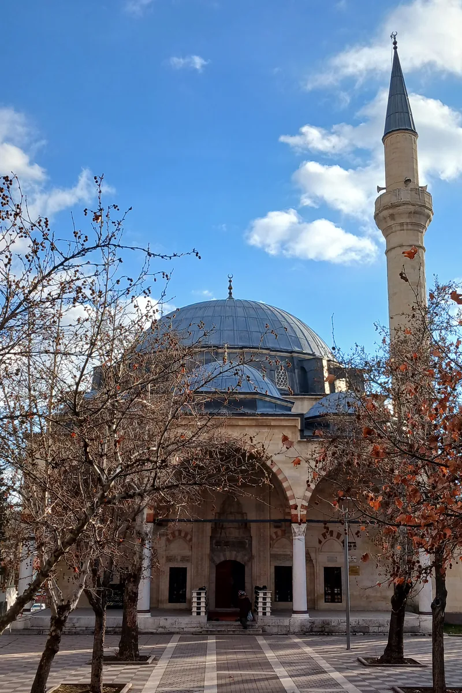
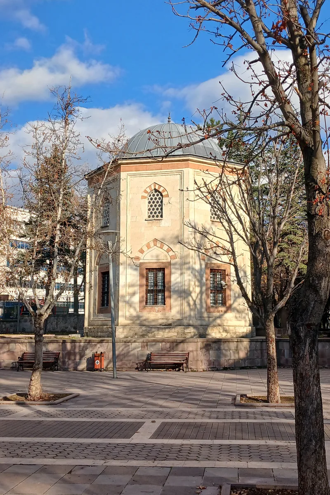
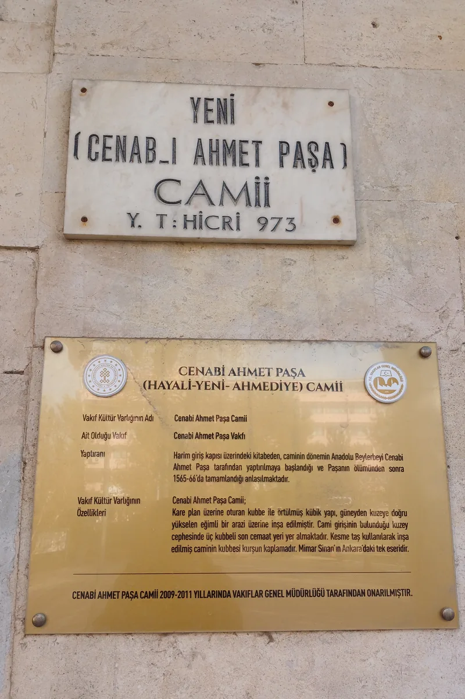

Ankara’nın Altındağ ilçesinde yükselen Cenabı Ahmet Paşa Camii, kitabesine göre 1565 yılında Kanuni Sultan Süleyman’ın vezirlerinden Cenabi Ahmed Paşa adına tamamlanmıştır. Tezkiret-ül Bünyan’da adının geçmesi nedeniyle Mimar Sinan’ın tasarladığı düşünülen yapı, aynı zamanda mimarın Ankara’daki tek eseri olarak kabul edilir. Düzgün kesme Ankara taşıyla inşa edilmiş klasik Osmanlı mimarisinin güzel bir örneğidir.

Kare planlı cami; tek minaresi, merkezi kubbesi ve son cemaat yerindeki kurşun kaplı kubbeleriyle dört kubbeli bir düzen sergiler. Öndeki üç büyük kemerle açılan son cemaat yerinin yanları açıktır. İç mekânda mihrap, minber ve giriş kapısı beyaz mermerden yapılmıştır; duvar ve kubbe yüzeylerindeki kalemişi süslemeler oldukça sadedir.

  
  
  

Cami, aynı arazi içindeki türbesi ve mezarlık alanıyla bir külliye oluşturur. 1972’de tescillenen yapı, 1887’den 2011’e kadar birçok kez onarılmış olmasına rağmen özgün karakterini büyük ölçüde korumuştur.
